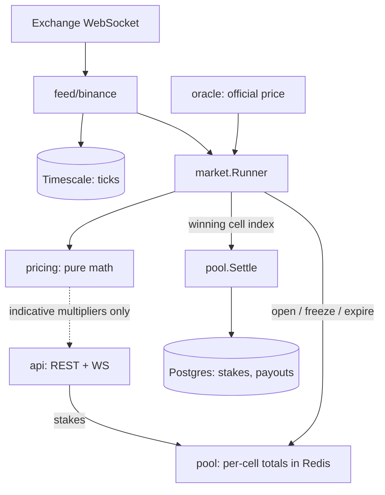

# Implementation Plan

A digital option pricing and pari-mutuel settlement engine over live asset
prices. A grid discretises a price/time chart into cells; each cell is a
binary option paying out if the underlying settles inside it at window close.
Positions are settled from the realised pool: the house takes a fixed rake and
distributes the remainder proportionally among correct positions.

## The invariant everything else serves

**Pricing informs. Settlement divides.** The pricing model estimates fair
probabilities and publishes indicative multipliers to the UI. The settlement
path computes payouts from realised pool totals and the oracle's official
price, and never reads a model output.

The consequence is that the house carries no directional exposure. If the
volatility estimate is badly wrong, participants get mispriced *indications*
and the house still collects exactly `rake × pool`. If settlement ever divided
by a model probability instead of a realised stake total, a bad vol estimate
would become a house loss — and that is a design failure, not a bug to patch.

Enforced structurally: `internal/pool` does not import `internal/pricing`, and
that stays true for the life of the project.

## High-level design



The dotted edge is the only path out of `pricing`, and it terminates at the
UI. No solid edge connects `pricing` to `SETTLE`.

| Component | Responsibility | Phase |
| --- | --- | --- |
| `pricing` | Lognormal cell probabilities and fair multipliers. Pure, no I/O. | 1 |
| `pool` | Stake accounting, rake, proportional settlement. Pure core + Redis adapter. | 2 |
| `feed` | Live tick stream from an exchange; also a deterministic simulator. | 3 |
| `oracle` | Fixes one official price at expiry. | 3 |
| `market` | Lifecycle state machine; owns the interfaces it consumes. | 4 |
| `store` | Timescale ticks, Postgres relational writes, Redis pool state. | 3–4 |
| `api` | REST for staking and market queries, WebSocket for live grid. | 4 |

## Folder structure

```
backend/               Go engine                                          [0]
  main.go              entrypoint, nothing but dispatch
  internal/
    cli/               subcommands and flag parsing                       [1-4]
    pricing/           lognormal distribution, grid, multipliers          [1]
    pool/              pari-mutuel accounting and settlement              [2]
    feed/              Tick, GBM simulator, Binance WebSocket client      [3]
    oracle/            last-trade settlement price                        [3]
    market/            interfaces, template, runner, series, ingestor     [3-4]
    store/             postgres, redis, embedded migrations               [3-4]
    api/               REST handlers, WebSocket stream                    [5]
frontend/              Next.js App Router UI                              [7]
  app/                 Server Components: layout and page
  components/          live-grid.tsx is the only client boundary
  lib/                 shared types mirroring the API payloads
analysis/              Python: calibration, Monte Carlo, vol surface      [5]
ai/                    Python sidecar: LangGraph risk monitor             [6]
db/init/               extension bootstrap, runs once on empty volume     [0]
```

One top-level directory per language, each with its own toolchain and its own
CI job. The Go module is `.../RTP-prediction-grid/backend`, so its import paths
stay honest about where the module actually lives.

Each language owns a top-level directory. `main.go` is the one Go file at the
root so the entrypoint stays where you look for it; everything else Go-shaped
is under `internal/`, which keeps the root readable once `web/` and `analysis/`
land beside it.

Directories appear in the phase that first needs them, not before.

## Layering

| Layer | Package | Imports |
| --- | --- | --- |
| Transport | `cli`, later `api` | everything below |
| Service | `market` | domain, adapters, repository |
| Repository | `store` | domain types only |
| Domain | `pricing`, `pool` | nothing |
| Adapters | `feed`, `oracle` | nothing |

Dependencies point inward: `pricing`, `pool`, `feed` and `oracle` import no
internal package at all, so the pricing and settlement maths compile and run
with no database, no clock and no network.

`store` deliberately stays one type rather than a repository per aggregate.
Settlement is a single transaction over four tables — `market`, `stake`,
`payout`, `ledger` — because a market cannot be observably settled with payouts
or balance credits missing. Splitting along aggregate lines would force
transaction plumbing between repositories to buy nothing at this size.

`market.Runner` holds `*store.Postgres` concretely rather than an interface it
defines. That is the one departure from strict layering, taken because the
project has one repository implementation and no need to run the service
without a database. It is worth revisiting when either changes.

## Low-level design

### `internal/pricing` — Phase 1

Pure functions. No clock, no network, no logging. Everything is an argument.

```go
type Grid struct {
    Lower, Upper float64 // inclusive price bounds, dollars
    CellWidth    float64
}

type Cell struct {
    Index        int
    Lower, Upper float64 // half-open [Lower, Upper)
}

type Params struct {
    Spot  float64
    Sigma float64        // see open question 1
    Drift float64        // per annum, decimal
    Tau   time.Duration  // time to expiry
}

func (g Grid) Cells() []Cell
func CellProbabilities(g Grid, p Params) []float64
func FairMultipliers(probs []float64, rakeBps int) []float64
```

Under geometric Brownian motion, `ln(S_T/S_0)` is normal with mean
`(μ − σ²/2)τ` and standard deviation `σ√τ`, so `S_T` is lognormal. A cell's
probability is the lognormal CDF at its upper bound minus the CDF at its
lower bound — closed form, no simulation.

Two invariants, asserted with generated inputs:

1. Cell probabilities sum to 1 across an exhaustive grid.
2. `multiplier × probability ≈ 1` at zero rake, within epsilon.

Exhaustiveness is the subtle part and depends on open question 2.

### `internal/pool` — Phase 2

Settlement core is a pure function so it can be exercised without Redis:

```go
type Payout struct {
    StakeID string
    Amount  int64
}

func Settle(stakes []Stake, winningCell int, rakeBps int) ([]Payout, error)
```

Given per-stake amounts and the winning cell index, it returns the split.
`gross = Σ stakes`, `net = gross − gross·rakeBps/10000`, and each correct
stake receives `net × stake/winningTotal`.

Edge cases, each an explicit branch:

| Case | Behaviour |
| --- | --- |
| No stake on the winning cell | Whole pool is house revenue, or refunded — open question 3 |
| Single participant overall | Receives `gross − rake`; they cannot beat the rake |
| Empty pool at freeze | Market voids; no rake, no payouts |
| Rounding remainder | Integer division leaves ≤ n−1 minor units; assigned deterministically, never dropped |

The Redis adapter wraps this: it holds live per-cell totals for the UI, but
settlement reads authoritative stakes from Postgres inside one transaction.

### `internal/market` — Phases 3–4

Declares the interfaces it consumes, which is the idiomatic Go placement:

```go
type PriceFeed interface {
    Subscribe(ctx context.Context, symbol string) (<-chan Tick, error)
}

type SettlementOracle interface {
    OfficialPrice(ctx context.Context, symbol string, at time.Time) (float64, error)
}
```

Go satisfies interfaces implicitly, so `feed/binance` and `feed/sim` never
import `market`. Dependencies point one way — concrete implementations stay
unaware of their consumer, and `main.go` does the wiring.

```go
type Template struct {
    Symbol       string
    Window       time.Duration
    FreezeBefore time.Duration
    CellWidth    float64
    RakeBps      int
}
```

Lifecycle: `Open → Frozen → Settled`, with `Open → Voided` when the pool is
empty at freeze and `Frozen → Voided` when the oracle cannot produce a price.

`FreezeBefore` is anti-latency-arbitrage. Without it, a participant with a
faster feed than the engine sees the settling move first and stakes on a cell
whose outcome is already largely determined — a risk-free extraction paid for
by everyone else in the pool. Freezing early enough to exceed plausible feed
latency removes the edge.

## Cross-cutting decisions

**Money is `int64` in minor units.** Never `float64`. Binary floating point
cannot represent 0.10 exactly, and a settlement that splits a pool among
winners does thousands of additions — the drift is real money. Field names
carry no unit suffix; the type is the contract, stated once at declaration.

**Prices are `float64` in dollars.** Prices are measurements, not balances;
they are multiplied and logged, never accumulated. Distinct from stakes on
purpose, so the compiler objects if the two are ever confused.

**Rake is `int` basis points.** 250 = 2.5%. Integer arithmetic end to end.

**Time is UTC throughout**, `timestamptz` in Postgres, `time.Time` in Go.
Market windows are wall-clock aligned.

**Errors wrap with `%w` and are never swallowed.** A settlement that fails
must abort the transaction and leave the market unsettled rather than pay
out partially.

## Verifying the model

The sum-to-one and multiplier invariants prove only self-consistency: a model
returning a uniform `1/N` for every cell satisfies both. Correctness is
established separately, by simulating the process the model claims to describe
and binning where it lands.

`TestProbabilitiesMatchSimulatedPaths` evolves GBM in discrete steps — the
log-Euler scheme is exact for GBM, so any step count must agree with the closed
form — and compares each cell's predicted probability against 400,000 simulated
terminal prices, judged as a binomial z-score so cells of very different
probability are held to one standard. Seven regimes pass: one step and sixty,
zero drift and both signs, volatility from 0.15 to 2.5, windows from 30 seconds
to an hour.

Three further checks pin down what the invariants cannot:

- **Martingale.** With zero drift `E[S_T] = S_0` for any volatility and horizon.
  Dropping the `-sigma^2/2` term breaks this and nothing else would notice.
- **Median below spot.** The median sits at `S_0 * exp(-sigma^2*tau/2)`, so more
  paths finish below the mean than above it.
- **Sigma bands.** The one, two and three sigma bands hold 0.6821, 0.9544 and
  0.9973 of the mass against textbook 0.6827, 0.9545 and 0.9973, the residual
  being cell discretisation.

### Tail precision

Cell probabilities are CDF differences. Differencing two values that both
approach 1 destroys the small number they differ by: measured relative error
reaches 4e-7 at six sigma and 6.7% at eight, where the value meets the float64
granularity floor of 2.2e-16.

Each cell is therefore differenced within whichever tail it occupies — cells
above the median use the upper-tail complement — which holds relative precision
past five sigma while leaving the sum within 5.6e-16 of one. It never touches
settlement, which reads no probabilities at all, but it makes far-tail
multipliers meaningful rather than noise.

## Testing posture

Tests where failure is invisible to inspection; running the thing everywhere
else.

Integration tests in `internal/market` exercise the real Postgres and Redis and
skip themselves when the stack is down, so `go test ./...` stays useful without
docker. They cover what unit tests structurally cannot: that a settlement
credits the ledger, that a voided market refunds rather than forfeits, that a
cancelled stake returns and decrements live totals, that a rejected stake
writes nothing, that concurrent stakes cannot overdraw an account, and that the
phase gates return their sentinel errors at the right moments.

The last of them asserts `deposited == spendable + escrowed + rake` over the
whole store, so money destroyed by any earlier run fails it. That is deliberate:
the void bug was caught twice from different directions, by this assertion and
by `make audit`.

- `pricing` — generated-input assertions on the two invariants. A probability
  set summing to 0.97 looks entirely normal on screen.
- `pool` — table-driven cases for the edge cases above. Each is a branch that
  either pays correctly or loses someone's money.
- Everything else — verified by running it. Phase 4 runs the full lifecycle
  against `feed/sim` before the real feed is connected.

No test files for wiring, adapters, or handlers.

## Phase map

| Phase | Deliverable | Done when |
| --- | --- | --- |
| 0 | Scaffold, compose, CI | ✅ `make up` healthy, `make lint` clean |
| 1 | Pricing module | ✅ `make grid` sums to 1.0; both invariants hold under generated inputs |
| 2 | Pool and settlement | ✅ every edge case in the table above behaves as specified |
| 3 | Feed and oracle | ✅ live Binance ticks land in Timescale; oracle fixes a price |
| 4 | Market orchestration | ✅ `make demo` runs open → freeze → settle → payout end to end |
| 4b | Concurrent series | ✅ `go run . series` holds six staggered expiries open at once |
| 4c | Position lifecycle | ✅ `make demo` walks amendable → committed → frozen and checks each |
| 4d | HTTP surface | ✅ `make serve` exposes REST plus a WebSocket pushing grid snapshots |
| 4e | Live client | ✅ Next.js grid renders the stream and stakes back through the API |
| 5 | Quant analysis | Calibration, Monte Carlo, vol surface — with written findings |
| 6 | AI layer | NL → `Template`; LangGraph risk monitor |
| 7 | Frontend and docs | Live grid, README, MIT licence, disclaimer |

## Decisions taken

These were open when the plan was written. Each is a one-line change if the
call was wrong.

**1. Volatility is annualised.** `Params.Sigma` and `Params.Drift` are per
annum, scaled by `sqrt(tau)` and `tau` with tau in years against a 365-day
calendar year (crypto trades continuously; an equity model would use 252
trading days). Annualised matches every external volatility source the Phase 5
comparison will pull from, so no conversion sits between the model and its
benchmark.

**2. The grid has open-ended tails.** Cell 0 is `(0, Floor)` and the last cell
is `[Ceiling, +Inf)`. Probabilities are consecutive CDF differences over this
partition, so the sum telescopes to `CDF(+Inf) - CDF(0) = 1` by construction
rather than by luck, and settlement can never face a price that belongs to no
cell.

**3. An unstaked winning cell refunds everyone in full, with no rake.** The
rake pays for distributing a pool; when nothing is distributed, nothing is
charged. The alternative — house keeps it — would give the operator an
interest in grids whose cells go unstaked, which is the wrong incentive to
build in. This is the most product-flavoured of the three and the easiest to
reverse.

### Position lifecycle

A market runs through three phases, and the order of the two deadlines is the
whole design:

| Phase | New positions | Withdrawals |
| --- | --- | --- |
| Amendable — open to `AmendsAt` | accepted | accepted |
| Committed — `AmendsAt` to `FreezesAt` | accepted | refused |
| Frozen — `FreezesAt` to expiry | refused | refused |

Withdrawals close *first*, and must: displayed multipliers are the pool's
composition, so a position that could be pulled at the last instant is a
spoofing tool — load a cell so it looks crowded, push others elsewhere,
withdraw, collect at inflated odds. Closing withdrawals before staking means no
withdrawal is ever the last move on the book.

This mirrors an exchange's matched/unmatched split: an unmatched order never
affected anyone and cancels freely, a matched one cannot. A pooled book has no
matching — every stake instantly moves everyone's odds — so the amendable phase
is a deliberate, bounded grace period rather than a natural property.

Cancelled stakes are soft-deleted (`stake.cancelled_at`) rather than removed. A
withdrawn position moved other people's odds while it stood, so it stays
auditable.

### Market series

A single `Market` is one *column* of the price/time grid: it partitions price
for one expiry. `Series` opens a new market every `Interval`, so with
`Interval < Window` several run concurrently on staggered expiries — the
columns the UI draws.

Each column keeps its own pool. Pooling across columns would mean exactly one
cell in the whole grid wins and every other column's stake transfers to it,
which is a lottery rather than a set of independent options.

Columns line up on the price axis for free: `GridAround` snaps a grid's floor
to a multiple of `CellWidth`, so consecutive markets share one price lattice
even as spot drifts.

### Recovery

`Market` values live only in memory and nothing reads the `market` table back,
so a market open at shutdown is stranded: it stays `open` or `frozen` forever
and its stakes stay escrowed with no settlement and no refund. The same happens
if `SetMarketState` or `Settle` errors mid-lifecycle.

The money is not destroyed — the audit still balances, since escrow counts
those stakes — but it is locked indefinitely. A resumable runner that loads
unsettled markets on startup and either settles or voids them is the missing
piece, and it is the reason the void path refunds rather than forfeits.

### The client boundary

`app/layout.tsx` and `app/page.tsx` are Server Components: they hold no state,
touch no browser API, and render once on the server. Everything that changes
with the tick stream lives in `components/live-grid.tsx`, marked `"use client"`,
because a WebSocket and the `useState` it feeds cannot exist on the server.

The split is observable rather than notional: the server-rendered HTML contains
the string "connecting to the engine" and no price at all. Prices only appear
once the client opens the socket.

The stream pushes whole snapshots every 250ms rather than deltas. At one symbol
and a few dozen cells a frame is about 7 KB, and it means a client that
reconnects or joins late is immediately correct with no replay protocol.

## Still open

**Pool concentration limits.** Nothing currently stops one participant taking
a dominant share of a cell, which makes their payout largely a refund of their
own stake minus rake. Phase 6's risk monitor is meant to observe this, but
whether the engine should *reject* such stakes is unresolved.

Splitting is not the lever it looks like: payouts are linear in stake, so
dividing a position across stakes or accounts gains at most one minor unit of
rounding — asserted in `TestSplittingGainsAtMostOneMinorUnit`. Any
concentration limit therefore has to bind on the *cell*, not the account, since
an account limit is defeated by opening a second account at no cost.

**Accounts and identity.** Accounts, balances and escrow are built: `account`
and `ledger` tables, a balance-checked `PlaceStake`, and an `audit` command
asserting `deposited == spendable + escrowed + rake`.

Authentication is deliberately absent. The intended answer is a browser wallet
(Phantom, MetaMask) once the core engine is finished: a signed message proves
control of an address, which supplies the account key and the funding rail in
one step, and removes any need to custody credentials. Until then accounts are
handles with play money, and the UI says so rather than implying otherwise.

**Grid recentring.** A market's grid is fixed at open. If the price runs far
before freeze, most cells carry negligible probability and staking concentrates
in the tail. Recentring mid-market would invalidate positions already taken, so
the alternative is shorter windows.
